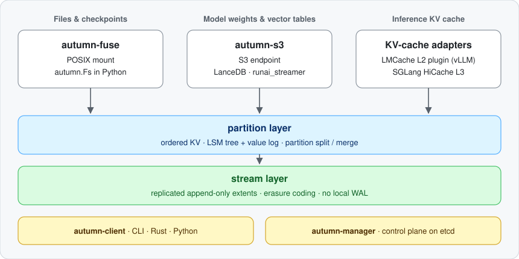

# autumn-rs

**One storage engine for AI data — models, datasets, vector tables and
inference KV cache on one data plane.**

autumn-rs is a distributed storage engine in Rust: replicated, append-only
extents under an ordered key-value store with partition split and merge, with
a manager on etcd. Files, KV pairs and S3 objects all land in the same extents.

<p align="center">
  
</p>

- **One copy of the data, three ways in:** a POSIX mount (`autumn-fuse`, or
  `autumn.Fs` in Python), a KV client (CLI, Rust, Python) and an S3 endpoint
  (`autumn-s3`). An object written over S3 is a file to the mount.
- **A KV-cache tier for inference engines:** an LMCache L2 plugin and the
  `autumn_kvcache` adapters (SGLang HiCache L3, vLLM connector), so prefix caches
  survive restarts and are shared across instances. An optional DRAM tier in
  the partition server acknowledges pages from memory and writes to disk behind.
- **Fast:** thread-per-core on io_uring, zero-copy RPC, optional UCX/RDMA.
  8 MiB writes from a client on a second host: 1,821 MB/s over UCX vs 414 MB/s
  over TCP; UCX 8 MiB reads reach ~87% of 100 GbE. 4 KiB KV on a Kubernetes
  cluster (3 PS, 5 EN on local NVMe, TCP, 64 keys per request): ~162K writes/s
  at p99 0.86 ms, ~507K reads/s at p99 0.38 ms.
- **Durable without a local WAL:** the replicated extents are the journal.
  Sealed extents are erasure-coded in the background; `autumn-op repair` and
  `scrub` rebuild degraded or rotted copies.
- **Elastic and operable:** partitions split and merge under an auto-policy
  controller; a web dashboard, `autumn-op status` / `health` / `df`, Prometheus
  `/metrics` on every server, opt-in authorization with Ed25519 capability
  tokens.

## Try it with docker compose

A one-host cluster from the published image, on a Docker host with a Linux
kernel ≥ 5.15: etcd, a manager, three extent nodes, a partition server and the
dashboard. Authz is off, there is one manager, and the nodes share one disk.

```bash
docker compose -f deploy/compose/docker-compose.yml up -d
docker compose -f deploy/compose/docker-compose.yml run --rm cli \
    sh -c 'echo hello > /tmp/v && autumn-client --manager manager:9001 --namespace kvc put greeting /tmp/v \
           && autumn-client --manager manager:9001 --namespace kvc get greeting'
# the dashboard: http://127.0.0.1:8799
docker compose -f deploy/compose/docker-compose.yml down -v       # stop and wipe
```

The cluster takes a few seconds to bootstrap after `up -d` returns; until it
has, the `put` fails with `routing error: key is out of range`. Run it again.

## Run it from source

Linux ≥ 5.15 (io_uring), Rust ≥ 1.95, `etcd` ≥ 3.5 in PATH; on x86_64 a CPU
with SSE4.2. Without systemd (containers, non-root) the deployer runs plain
processes.

```bash
cargo build --release -p autumn-server
cd deploy/baremetal
./autumn-deploy -t topology-singlehost.conf start   # etcd + manager + 3 ENs + 1 PS, bootstrapped
./autumn-deploy -t topology-singlehost.conf status

# Nothing is served until its namespace exists: enable what you use.
AO="../../target/release/autumn-op --cluster-secret-file $HOME/.autumn-deploy/cluster.secret --manager 127.0.0.1:9001"
$AO namespace-create --name fs --parts 6     # files: autumn-fuse / autumnfs / autumn.Fs / autumn-s3
$AO namespace-create --name kvc --parts 16   # KV cache: sglang / vLLM adapters

./autumn-deploy -t topology-singlehost.conf destroy --wipe   # tear down
```

Authz is on by default: `start` writes one credential per namespace under
`$HOME/.autumn-deploy/authz/`, and the clients below pass it.

## Use it

**KV.** `autumn-client put|get|ls|put-stream` against a namespace; Rust via
`autumn_client::ClusterClient` (`crates/client`); Python via
`pip install autumn-rs` (`autumn.Client`, see [`python/README.md`](python/README.md)).

```bash
AC="./target/release/autumn-client --manager 127.0.0.1:9001 --namespace kvc \
    --credential-file $HOME/.autumn-deploy/authz/kvc.cred"
echo hello | $AC put mykey /dev/stdin
$AC get mykey                                       # → hello
```

**Files.** A POSIX mount for models, datasets and checkpoints; reads go through
the kernel page cache and the daemon's own parallel readahead. The same tree is
reachable without a mount from Python (`autumn.Fs.connect("127.0.0.1:9001")`)
and from the shell (`autumnfs`).

```bash
cargo build --release -p autumn-fuse           # needs libfuse3-dev
mkdir -p /mnt/autumn
./target/release/autumn-fuse --manager 127.0.0.1:9001 --mountpoint /mnt/autumn --transport tcp \
    --credential-file $HOME/.autumn-deploy/authz/fs.cred &
cp model.safetensors /mnt/autumn/              # a regular filesystem, backed by the cluster
```

**S3: model weights and vector tables.** `autumn-s3` serves the file tree as an
S3 endpoint (reads, writes, copy, delete, multipart, conditional writes); a
bucket is a first-level directory, created beforehand. Point vLLM / SGLang's
stock `--load-format runai_streamer` at it to stream weights with no engine
patches, or run the stock LanceDB client against it.

```bash
./target/release/autumnfs --manager 127.0.0.1:9001 --credential-file $HOME/.autumn-deploy/authz/fs.cred mkdir /tables
./target/release/autumn-s3 --manager 127.0.0.1:9001 --port 9100 --credential-file $HOME/.autumn-deploy/authz/fs.cred &
cd examples/lancedb-s3 && uv sync
uv run python workload.py http://127.0.0.1:9100 tables demo    # create, append, search, optimize, verify
```

**Inference KV cache.** For LMCache (and vLLM through it), the autumn L2
plugin lives in [LMCache/lmcache_l2_plugins](https://github.com/LMCache/lmcache_l2_plugins):
`pip install "lmcache-l2-plugins[autumn] @ git+https://github.com/LMCache/lmcache_l2_plugins"`.
For SGLang HiCache, install the
[`autumn_kvcache`](https://github.com/journeymidnight/autumn_kvcache) adapter.
Both are pure Python on the `autumn` package, no extra daemon.
To serve pages from DRAM, start the partition server with
`--mem-tier-bytes <N> --mem-tier-prefix kvc/`; a crash loses only what had not
landed on disk yet, so keep it to data that can be recomputed.

## License

Apache-2.0 — see [`LICENSE`](LICENSE).
